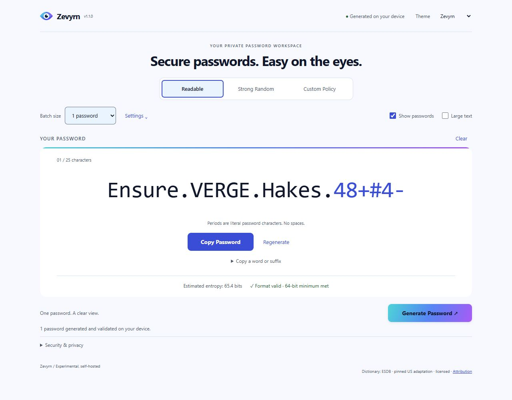
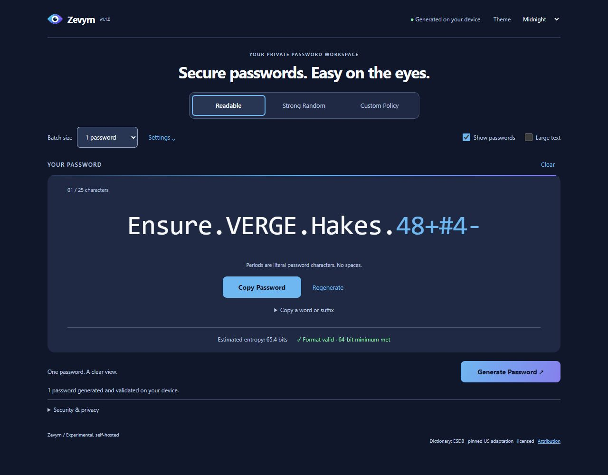
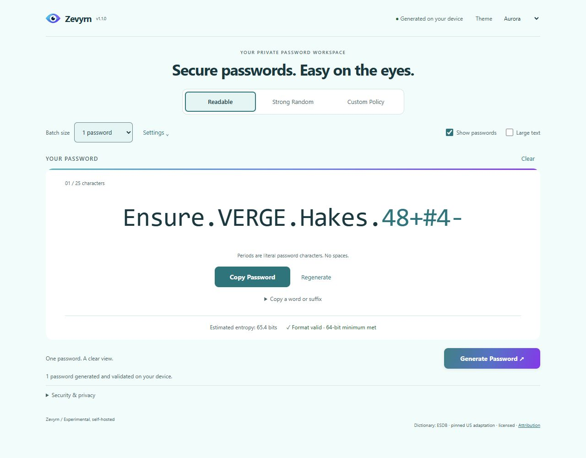
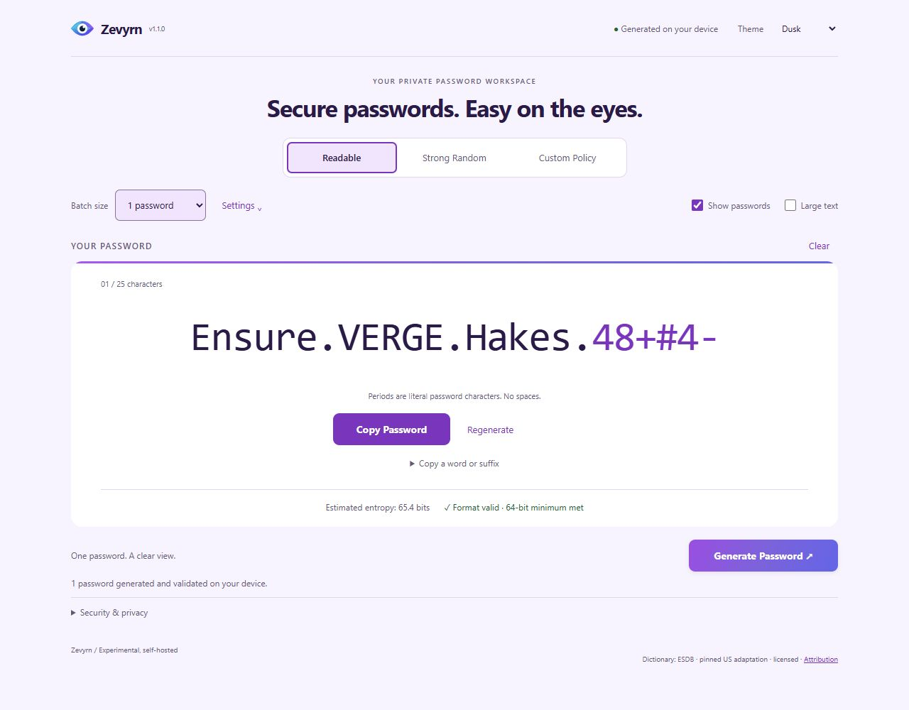
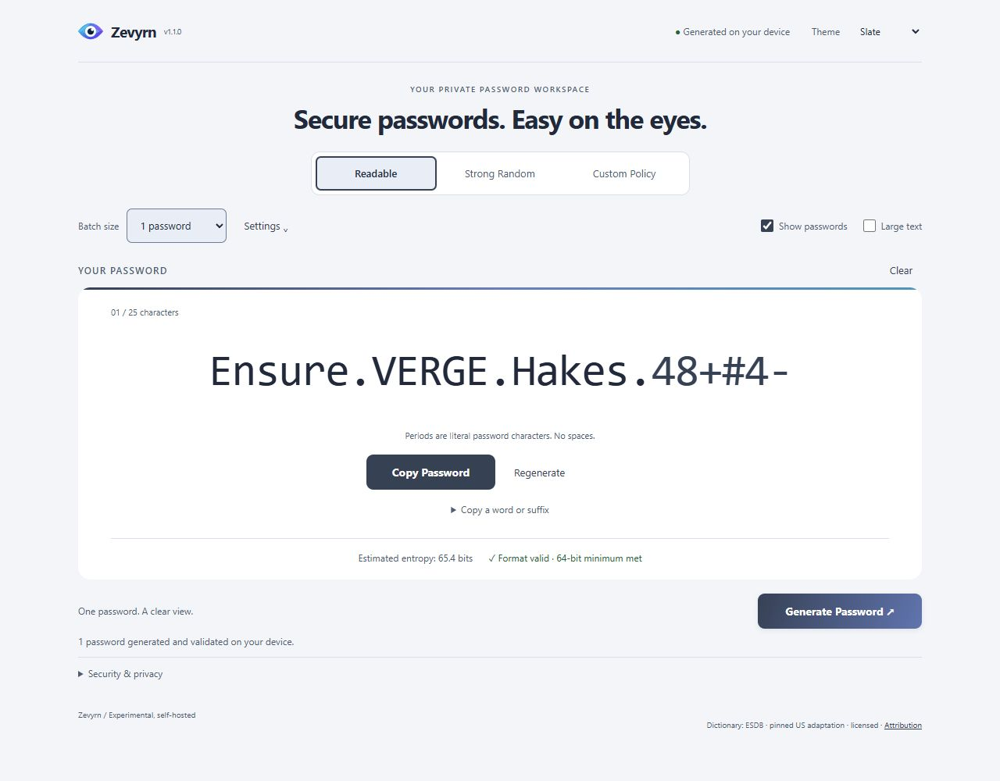
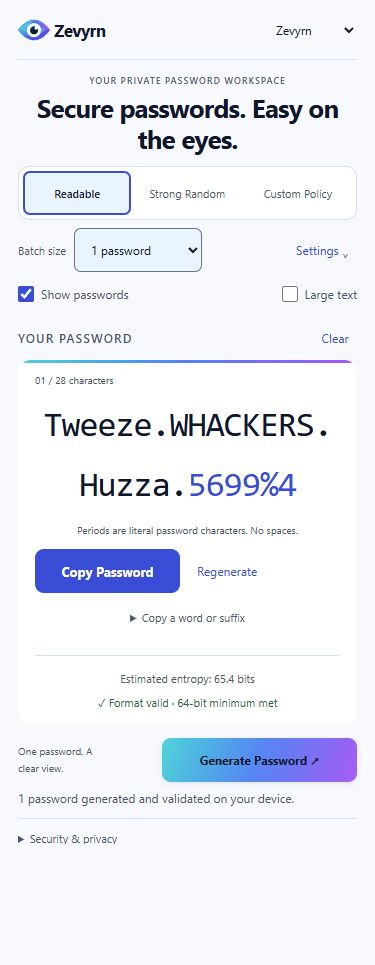
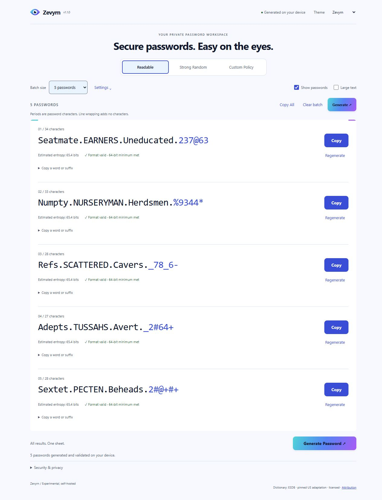

# Zevyrn

**Secure passwords. Easy on the eyes.**

Current application version: **1.2.0**.

Self-hosted password generation in your browser. Zevyrn provides Readable,
Strong Random and Custom Policy profiles, single-password and batch views,
copying controls, Large Text and five themes: Zevyrn (default), Midnight, Aurora, Dusk and Slate.

Passwords are generated on your device using Web Crypto. There is no backend
password storage, telemetry or external dictionary service. Only the selected
theme is saved. Clear does not erase OS clipboard history or securely wipe memory.

## Install from source

There is currently no official published Zevyrn container image. Build from
this repository; the new-install image is named `zevyrn:1.2.0-local`.
Existing installations retain their original configuration and image names.

Requirements: Linux/amd64 containers, Git, maintained Docker Engine 28 or newer,
Docker Compose plugin with `--wait`, and Buildx. Docker Desktop must use Linux
containers. Node/npm are included in the build; they are not host prerequisites.
The first build needs access to container registries, npm and Alpine repositories.

On Ubuntu, follow [Docker's official apt repository setup](https://docs.docker.com/engine/install/ubuntu/#install-using-the-apt-repository),
including the Compose and Buildx plugins. Do not reinstall Docker if it is already
working. Commands below use a POSIX shell; prefix Docker commands with `sudo` if
your account does not have Docker access.

```sh
git clone https://github.com/TheStateOfWhere/zevyrn-password-generator.git zevyrn-password-generator
cd zevyrn-password-generator
docker version
docker compose version
docker buildx version
docker compose -p zevyrn -f compose.zevyrn.yaml build zevyrn
docker compose -p zevyrn -f compose.zevyrn.yaml up -d --no-build --pull never --wait --wait-timeout 120
curl --fail http://127.0.0.1:18080/healthz
```

Expect `ok`. Open **http://localhost:18080** on the Docker host. If Docker runs on
a remote server, localhost refers to that server; use the HTTPS instructions below
for remote browser access. This loopback-only setup does not publish the app to
other machines. Change its port with `ZEVYRN_PORT=18081 docker compose -p zevyrn -f compose.zevyrn.yaml ...` and
use the same setting for subsequent commands.

The Dockerfile runs the application tests during the build. Builds intentionally
fail when pinned inputs are unavailable; do not bypass tests or remove the pins.

## HTTPS: choose Traefik or Caddy

See [INSTALLATION.md](INSTALLATION.md) for complete commands using an existing
certificate. Both examples create their own project network, publish only TCP 443,
and route to `zevyrn:8080`. No Docker socket or external proxy network is needed.
Use one complete Compose file at a time; do not combine the alternatives.

| Option | Compose file | Browser address |
| --- | --- | --- |
| Local only | `compose.zevyrn.yaml` | `http://localhost:18080` |
| Traefik + existing certificate | `compose.zevyrn.traefik.yaml` | `https://<your-domain>` |
| Caddy + existing certificate | `compose.zevyrn.caddy.yaml` | `https://<your-domain>` |

Provide a DNS record pointing to your Docker host, a certificate whose DNS SAN
matches that name, and client trust in the issuing CA. Private hostnames need a
trusted private-CA certificate. The examples do not issue certificates or create
a CA. Keep private keys outside this repository. Port 80 is not required by these
existing-certificate examples. HTTPS or localhost is required for browser copying.

Choose a hostname you control and set `ZEVYRN_DOMAIN` to that bare name, without
`https://` or a port. Public DNS and internal DNS are both supported; clients must
use a resolver that knows the record. A public DNS name does not require public
Internet access to the application. See [DNS and certificate trust](INSTALLATION.md#choose-a-hostname-and-client-trust)
and the [update commands](INSTALLATION.md#updates).

## Troubleshooting

```sh
docker compose -p zevyrn -f compose.zevyrn.yaml ps
docker compose -p zevyrn -f compose.zevyrn.yaml logs --tail 100 zevyrn
curl --fail http://127.0.0.1:18080/healthz
```

For HTTPS, use the same `-p` and `-f` options as your installation when checking
status or logs. A 502 usually means the app is unhealthy or the proxy cannot reach
`zevyrn:8080`. A certificate warning means the hostname, chain, expiry or client
trust needs attention; do not treat `curl -k` as a successful HTTPS test.
If a port is occupied, choose another port or host address; do not stop another
application. A missing local image requires the explicit build step above.
See [INSTALLATION.md](INSTALLATION.md) for updates and removal.

## Existing installations

Keep your original Compose file, project, service, environment variables and TLS
paths. The legacy `compose.yaml`, `compose.traefik.yaml`, `compose.caddy.yaml`,
`.env.example` and proxy configurations remain unchanged. Do not switch projects
or services just to update. Follow the [existing-installation update path](INSTALLATION.md#existing-installations).
The new Zevyrn files are complete alternatives, not overlays on legacy files.

## Screenshots

Captured from the real Zevyrn v1.1.0 application at 1280px desktop and 390px
mobile widths. All five approved themes are shown below. Any visible passwords
are public examples generated for these screenshots and must not be used as
credentials. The compact mobile header hides the version label; desktop captures
show v1.1.0.

### Desktop — Zevyrn theme



### Desktop — Midnight theme



### Desktop — Aurora theme



### Desktop — Dusk theme



### Desktop — Slate theme



### Mobile responsive layout



### Five-password batch



## Development and licensing

See [CONTRIBUTING.md](CONTRIBUTING.md) for local tests and [SECURITY.md](SECURITY.md)
for reporting and security boundaries. Other CPU architectures and physical mobile,
screen-reader and full cross-browser behavior have not been qualified. Existing
automated browser coverage uses Microsoft Edge on Windows.

Application: [MIT](LICENSE). Dictionary data retains its separate licenses and
[attribution](data/NOTICE.md). Application and third-party notices are included in
the built `/licenses/` assets. Historical project names in `data/NOTICE.md` are
retained verbatim to preserve pinned dictionary attribution and provenance; the
current product name is Zevyrn.

Project: [TheStateOfWhere/zevyrn-password-generator](https://github.com/TheStateOfWhere/zevyrn-password-generator).
The [repository rename notes](docs/REPOSITORY-RENAME.md) describe the completed
rename and retained compatibility identifiers. Existing Docker image,
service, project and `KEYSMITH_*` configuration names remain compatible.
